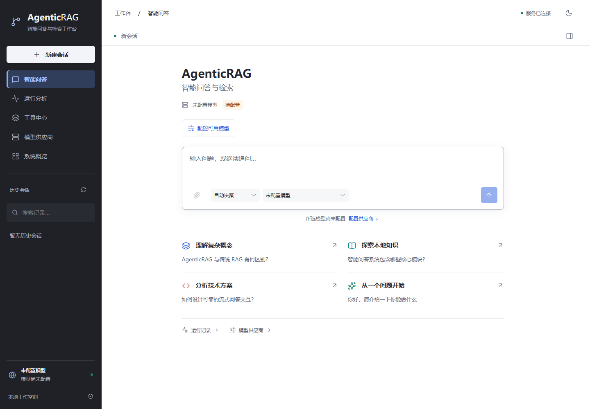

# AgenticRAG 智能搜索与问答系统

基于 Vue 3 与 FastAPI 的智能问答工作台，通过 Router、Planner、Retriever、Generator、Critic 五类智能体按需组织检索与生成流程。支持本地文档知识库、联网搜索、多轮流式对话，以及回答引用和执行过程可视化。



## 功能

- **智能问答**：多会话与历史恢复、模型选择、检索范围选择、图片附件、流式回答与停止生成。
- **本地知识库**：创建与管理资料库，上传 TXT、Markdown、文本型 PDF，查看索引进度，重试或取消任务。
- **混合检索**：BGE 中文语义嵌入、ChromaDB 向量检索与 BM25 关键词检索，通过 RRF 融合排名，按所选知识库限定检索范围。
- **联网搜索**：接入 Tavily，将网页链接与摘要作为回答证据；支持本地资料与联网结果组合检索。
- **引用与执行分析**：查看原文片段、PDF 页码、节点时间线、耗时瀑布图、工具调用与历史运行记录。
- **模型供应商管理**：配置模型服务、发现模型、设置默认模型，区分凭据配置、模型列表连接与生成调用状态。
- **交互与展示**：Markdown 安全渲染、代码高亮与复制、滚动跟随、明暗主题及窄屏布局。

## 技术栈

| 层次 | 技术 | 用途 |
| --- | --- | --- |
| 前端 | Vue 3、TypeScript、Vite、Vue Router、Pinia | 组件、路由、类型与会话状态管理 |
| 界面 | Element Plus、SCSS、CSS 变量 | 表单、抽屉、主题与响应式布局 |
| 内容渲染 | markdown-it、DOMPurify、highlight.js | Markdown 解析、内容净化和代码高亮 |
| 流式通信 | Fetch、ReadableStream、SSE、AbortController | 增量响应、执行事件与请求取消 |
| 后端 | Python、FastAPI、Pydantic、HTTPX | API、参数校验、模型与外部服务调用 |
| 本地检索 | FastEmbed / ONNX Runtime、BGE、ChromaDB、BM25、RRF | 中文语义嵌入、向量与关键词融合检索 |
| 联网检索 | Tavily Search API | 网页搜索与证据摘要 |
| 持久化 | SQLite | 会话、消息、运行事件、供应商配置及文档索引任务 |
| 检查与测试 | ESLint、Prettier、vue-tsc、Vitest、Playwright、pytest | 静态检查与核心流程测试 |

## 执行流程

```text
Vue 工作台 → FastAPI → Router
                       ├─ 直接回答 ──────────────────┐
                       ├─ Retriever ────────────────┤
                       └─ Planner → Retriever ──────┤
                                                   ↓
                                              Generator
                                                   ↓
                                                Critic
                                                   ↓
                                      最终回答、来源与 SQLite 历史

Retriever → 本地知识库 / Tavily / 已注册工具
执行阶段与回答增量 → SSE → 会话页面与执行详情
```

Router 根据问题与用户选择确定处理路径；Planner 为复杂问题生成受限的检索子问题；Retriever 执行检索计划；Generator 融合证据生成回答；Critic 检查引用结构与证据边界，并可触发受限修订。简单请求不必经过全部节点。详细流程见 [系统架构](docs/architecture.md)。

## 快速开始

### 环境

- Node.js **24.15+**，npm（使用 `frontend/package-lock.json`）。
- Python **3.13**；直接依赖约束见 `requirements-verified.txt`。
- 以下命令使用 Windows PowerShell，在项目根目录执行。

### 安装与启动

```powershell
git clone https://github.com/spark0v0/AgenticRAG-Intelligent-QA-System.git
cd AgenticRAG-Intelligent-QA-System
python -m venv .venv
.\.venv\Scripts\python.exe -m pip install -r requirements.txt -c requirements-verified.txt
npm --prefix frontend ci
npm --prefix frontend run build
powershell -ExecutionPolicy Bypass -File scripts/start-workbench.ps1
```

访问 [问答工作台](http://127.0.0.1:8000/chat)。前端构建由 FastAPI 同源提供，支持已配置的 SPA 路由刷新。API 文档位于 [Swagger UI](http://127.0.0.1:8000/docs)。默认监听本机并使用单个 Uvicorn worker。

自定义端口：

```powershell
powershell -ExecutionPolicy Bypass -File scripts/start-workbench.ps1 -Port 8001
```

### 配置回答模型

打开「模型供应商」，添加服务地址、凭据和模型 ID，配置流式或图片能力并设为默认模型。支持 OpenAI 兼容接口、DeepSeek、Ollama 和 Xinference；OpenAI 兼容接口与 DeepSeek 可使用真实增量响应，Ollama、Xinference 和关闭流式能力的配置使用完整结果模式。

连接检查请求供应商的模型列表，不发送问答。完成一次问答后，系统才会记录该模型的生成调用成功状态。模型配置也可通过 `config/config.yaml` 与后端环境变量提供。

### 配置 Tavily 联网搜索

首次使用环境文件时复制模板；如果已有 `.env`，直接编辑，保留原有配置：

```powershell
Copy-Item .env.example .env
```

在根目录 `.env` 中设置：

```dotenv
WEB_SEARCH_PROVIDER=tavily
TAVILY_API_KEY=your_tavily_api_key
```

重启后端，在输入区选择「联网搜索」或「本地 + 联网」。调用链为：

```text
Retriever → web_search 工具 → HTTPX → Tavily /search
          → 网页标题、链接与摘要 → Generator → 带引用的回答
```

后端通过 `httpx.AsyncClient` 调用 Tavily HTTP API，使用 `basic` 搜索，不请求 Tavily 生成答案。此路径不依赖 MCP 或 Tavily SDK。搜索失败会返回对应错误，不自动切换供应商或重复请求；Tavily 的调用额度由服务账户管理。

未设置 `WEB_SEARCH_PROVIDER` 时，有 Tavily Key 则选择 Tavily，否则使用覆盖有限的 Wikipedia 与 DuckDuckGo 即时答案接口。也可显式配置 `WEB_SEARCH_PROVIDER=public`。显式选择 Tavily 但没有 Key 时会提示未配置。

### 准备本地知识库

仅关键词模式无需嵌入模型。使用语义或混合检索前，先下载模型：

```powershell
$env:PYTHONUTF8 = '1'
.\.venv\Scripts\python.exe scripts/prepare_embedding.py
```

默认模型为 `BAAI/bge-small-zh-v1.5`，通过 FastEmbed / ONNX Runtime 在 CPU 上运行，输出 512 维向量。模型需要首次下载并占用本机磁盘、CPU 和内存；运行时只读取本地缓存，缺少模型会明确报错。

进入 [知识库](http://127.0.0.1:8000/knowledge)，创建资料库并上传文件，索引完成后可检索预览或进入问答。每次最多 8 个文件，单文件不超过 10 MiB，整个上传请求不超过 32 MiB；文本需为 UTF-8，PDF 需包含可提取文字，不支持 OCR。完整说明见 [知识库文档](docs/knowledge-workbench.md)。

## 本地开发

保持后端运行，在另一个 PowerShell 窗口启动 Vite：

```powershell
npm --prefix frontend run dev
```

访问 [Vite 开发页面](http://127.0.0.1:5173)。`/api` 默认代理到端口 8000；后端使用其他端口时设置 `VITE_API_TARGET` 后启动开发服务。

```powershell
$env:VITE_API_TARGET = 'http://127.0.0.1:8001'
npm --prefix frontend run dev
```

生产资源更新后重新执行 `npm --prefix frontend run build` 并重启后端。`vite preview` 仅提供静态预览，不替代后端服务。

## 目录

```text
frontend/src/
  api/             API 适配与 SSE 解析
  types/           消息、来源、任务和事件类型
  stores/          会话与知识库共享状态
  composables/     滚动、文档轮询、运行分析等逻辑
  components/      问答、文档、供应商与执行详情组件
  views/           页面
  router/ styles/  路由与主题样式
src/
  api/             FastAPI 路由
  agents/          五类智能体
  core/            执行流程编排
  knowledge/       文档解析、索引任务与语义检索
  retrieval/       项目资料检索
  tools/ models/   工具与模型适配
  memory/          SQLite 持久化
scripts/           启动、模型准备和检索比较
tests/            后端与浏览器服务夹具
```

## 数据与配置

- **SQLite**：保存会话消息、运行事件、供应商配置，以及知识库的文档、片段和任务状态。
- **ChromaDB**：保存检索向量；用户知识库与项目资料索引分开维护。
- **本地文件**：上传原文和模型缓存保存在 `data/knowledge/`；通过 `AGENTICRAG_KNOWLEDGE_DIR`、`AGENTICRAG_EMBEDDING_CACHE` 可更换目录。
- **凭据**：留在后端环境变量或供应商存储中，不放入 `VITE_*`、浏览器持久化或 Git。Windows 供应商凭据使用当前用户 DPAPI 加密，其他系统采用受文件权限限制的本地存储。
- **备份与迁移**：停止服务后备份数据目录。旧 JSON 会话可幂等导入 SQLite，索引重建保留原文和历史证据；详见 [接口与存储](docs/api-and-storage.md)。

`.env`、`data/`、数据库、模型缓存、日志和测试产物均不纳入版本控制。

## 检查与测试

```powershell
npm --prefix frontend run lint
npm --prefix frontend run format:check
npm --prefix frontend run smoke
npm --prefix frontend run build
.\.venv\Scripts\python.exe -m pytest tests/test_workbench_smoke.py tests/test_provider_settings.py tests/test_agent_upgrade.py tests/test_knowledge_smoke.py -q
```

默认测试使用隔离数据和服务夹具，不需要真实 API Key。浏览器测试、模型检索比较与临时目录配置见 [测试说明](docs/verification.md)。GitHub Actions 执行静态检查、核心测试和前端构建。

## 当前边界

- 面向本机单用户运行，使用单进程索引队列，未提供公网认证或多 worker 任务协调。
- Critic 检查引用结构与证据边界，不进行逐句事实核验。
- 用户知识库使用真实 BGE 语义嵌入；未选知识库时的项目资料检索使用 BM25 与哈希向量，二者并非同一种检索实现。
- Tavily 返回搜索摘要，未实现网页全文抓取；图片问答取决于所选模型能力。
- 取消会终止后续执行并关闭支持异步取消的连接；同步工具可能执行到检查点或超时。
- Function Calling 为可选工具选择适配，默认采用策略选择；MCP 提供本地示例服务，Dify 提供工具包装，尚未发布完整插件。

## 文档

- [系统架构](docs/architecture.md)
- [前端设计](docs/frontend-design.md)
- [接口、SSE 与存储](docs/api-and-storage.md)
- [知识库与索引维护](docs/knowledge-workbench.md)
- [测试说明](docs/verification.md)
- [后续规划](docs/roadmap.md)

项目延续自 [AgenticRAG](https://github.com/spark0v0/AgenticRAG)。
