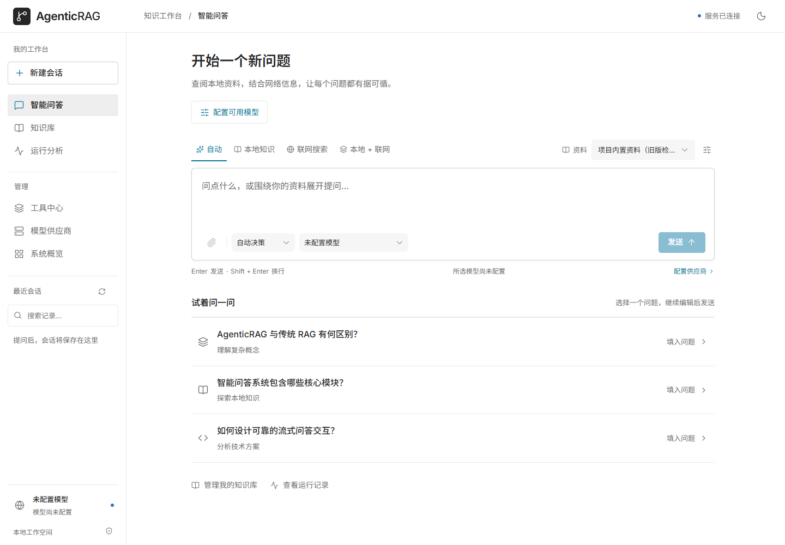
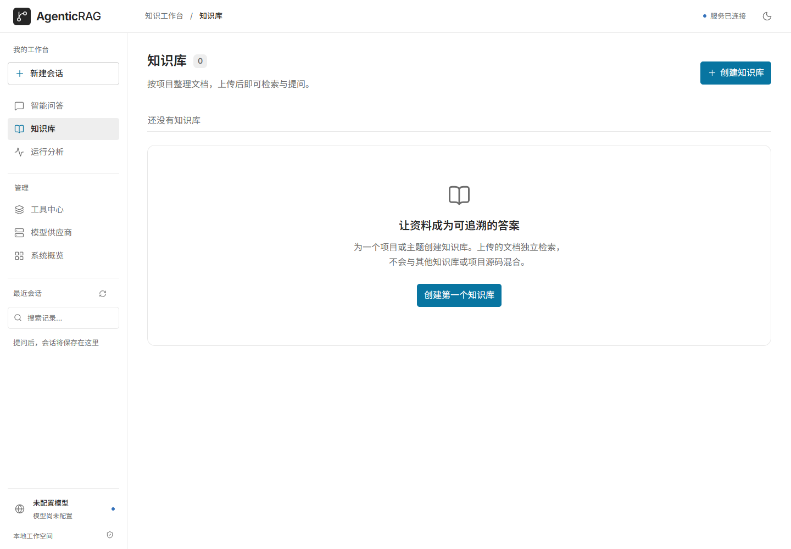
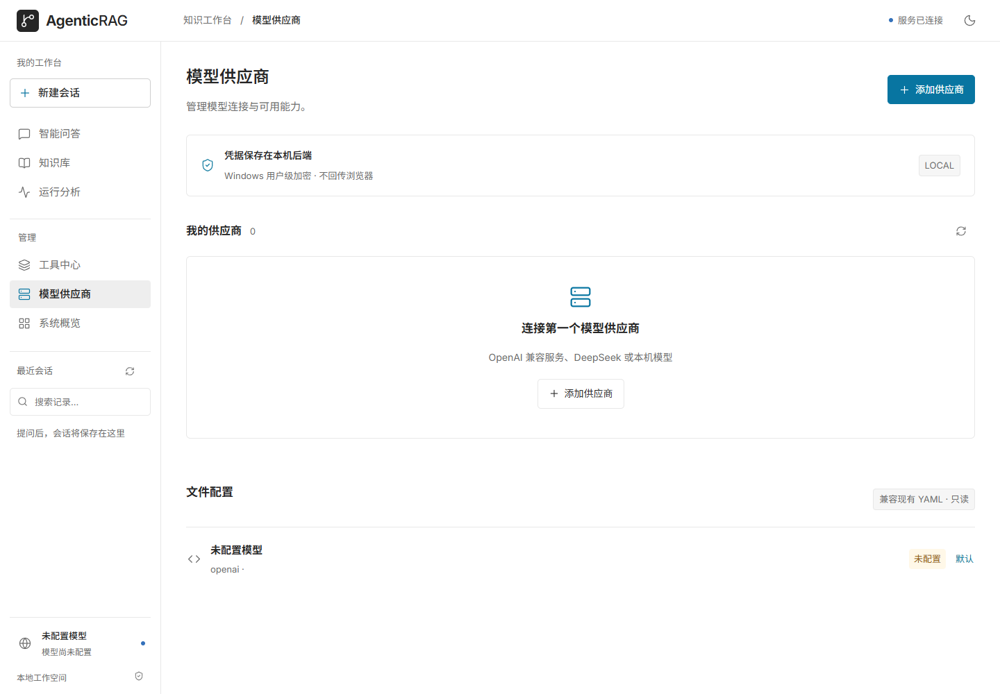
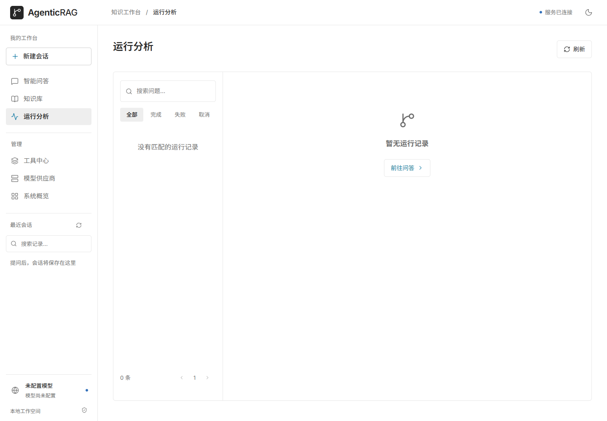
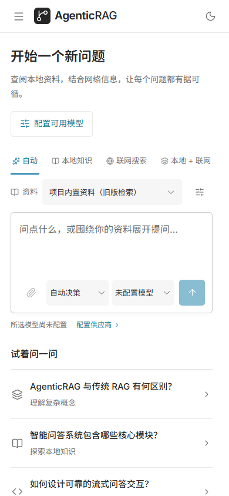
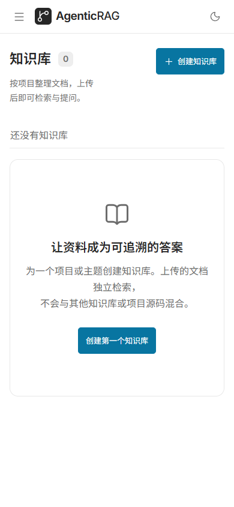
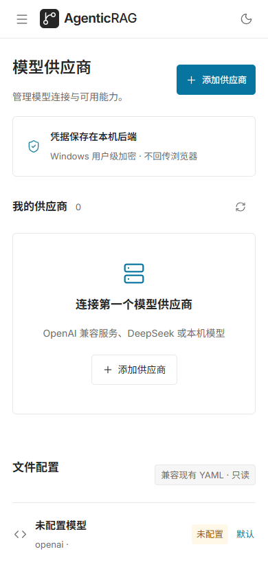
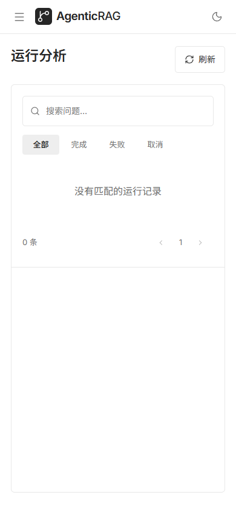

# 界面截图

更新于 2026-10-17，使用当前生产构建截取。桌面视口为 1440 × 1000，窄屏为 390 × 844。

截图来自独立临时工作区，未配置模型、供应商、知识库或会话，不加载本机 `.env`，不调用模型或搜索服务。

## 桌面

### 智能问答



### 知识库



### 模型供应商



### 运行分析



## 窄屏

| 智能问答 | 知识库 |
| --- | --- |
|  |  |

| 模型供应商 | 运行分析 |
| --- | --- |
|  |  |

## 更新截图

在项目根目录的 PowerShell 中构建并启动临时服务：

```powershell
npm --prefix frontend run build
.\.venv\Scripts\python.exe tests/serve_screenshots.py
```

另开终端，在项目根目录运行（使用已安装的 Edge）：

```powershell
$env:PLAYWRIGHT_CHANNEL = 'msedge'
$env:WORKBENCH_SCREENSHOT_DIR = 'docs/screenshots'
node frontend/scripts/capture-workspace.mjs
```

脚本默认连接 `http://127.0.0.1:8005`，也可通过 `WORKBENCH_URL` 指定地址；截图前检查工作区为空，等待字体加载，并记录页面错误与横向溢出情况。结果保存在 `workbench-metrics.json`。完成后在服务终端按 `Ctrl+C`，释放临时数据。

Playwright 业务截图仍写入被 Git 忽略的 `frontend/test-results/`，不作为真实模型输出示例。
